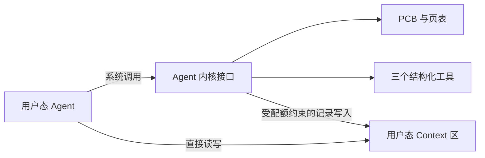

# Agent-OS 设计与基础任务验收

Agent-OS 在 xv6-riscv 内核中提供 Agent 进程、结构化工具调用与上下文路径。Agent 的策略和循环由用户程序执行，内核管理地址空间、配额、路径元信息及工具访问。



## Agent 进程

`agent_create(1, interval, quota)` 复用 xv6 子进程创建路径。父进程返回子 PID，子进程返回 0。类型、心跳间隔、Context 配额及 Loop 状态写入子进程的 PCB，子进程在初始化完成后才进入可运行状态。心跳间隔须为非负数，配额须为 4096–65536 字节且按页对齐。失败返回 -1。

Agent Context 使用 `TRAPFRAME - 65536` 开始的独立用户映射，内核以配额预留地址，首次直接访问或系统调用跨入未提交的 Context 页时，按最多 4 页为一批分配。页面可读写且不可执行。原有 ELF、栈和堆布局保持 xv6 的顺序，Context 保留区和堆之间有一页未映射的保护区。eager 和 lazy `sbrk` 都遵守 Agent 的堆上限。普通 `fork` 创建普通进程，Agent 子进程须通过 `agent_create` 创建，Context 初始为空。成功 `exec` 释放旧 Context 并恢复普通进程，失败的 `exec` 保留原状态。进程回收时释放剩余映射。

`agent_info(pid, &info)` 查询自身或直属 Agent 子进程。查询成功返回 0，失败返回 -1。只有查询自身时，`context_base` 才是可用地址。基础任务的 Loop 状态初始化为 idle，心跳间隔作为元信息保存。

## 上下文路径

`kernel/agent_abi.h` 定义用户态可访问的布局。Context 由 256 字节记录组成，每条记录含 tick、长度与最多 240 字节的数据。`agent_info` 返回槽位数量所需的配额，以及逻辑头位置和有效记录数。逻辑索引 `i` 的槽位为 `(head + i) % (quota / 256)`。

| 系统调用 | 成功行为 |
|---|---|
| `context_push(data, len)` | 接受 1–240 字节摘要，追加记录，满时覆盖最旧记录，返回 0 |
| `context_query(index, buf, len)` | 从最旧记录开始按零基索引查询，复制数据并返回实际字节数 |
| `context_rollback(n)` | 从末尾移除最近 n 条记录，n 可为 0，返回 0 |
| `context_clear()` | 重置逻辑路径，返回 0 |

回溯和清空更新有效记录范围，保留页用于后续写入。用户态可直接读写记录，内核从 PCB 的可信长度表取得复制长度。记录中的摘要与时间戳可由所属 Agent 修改。用户态负责决定何时把工具请求和结果摘要写入路径。

## 工具协议

`kernel/agent_proto.h` 定义 12 字节请求头和 12 字节响应头。使用 RISC-V 64 小端字节序。请求由头、全部键值长度描述符、按顺序排列的键和值字节组成。键和值不带 NUL，`flags` 须为 0，`payload_len` 须与实际字节数相符。响应数据紧跟头部，解码时复制到按类型对齐的对象。

| 编号 | 工具与参数 | 响应数据 |
|---|---|---|
| 1 | `query_process`，可选 `status` 和 `type`。状态为 `used`、`sleeping`、`runnable`、`running` 或 `zombie`，类型为 `ordinary` 或 `agent` | `agent_proc_row` 数组，允许为空 |
| 3 | `read_context`，必填十进制无符号 `index` | 当前 Agent 的一条 `agent_record` |
| 5 | `get_system_status`，无参数 | `agent_system_status`，含 uptime 和各状态进程计数 |

`tool_list(0, 0)` 查询工具清单所需长度，随后传入缓冲区可读取按行排列的工具编号、名称和参数说明，返回字节数不含 NUL。`tool_call` 成功返回 0，失败返回协议定义的负错误码。响应头可写时同步输出工具错误状态，失败响应的数据长度为 0。进程信息按条加锁读取，系统状态是巡检期间的采样。

## 复现与验证

环境为 Ubuntu 24.04（WSL2）、RISC-V GCC 13.3.0、QEMU 8.2.2 和 clang-format 20.1.8。

```bash
make kernel/kernel fs.img
./test-xv6.py agenttests
./test-xv6.py usertests
./test-xv6.py crash
```

`agenttests` 核对普通父进程和 Agent 子进程共存、三个工具的六轮调用和上下文直读，并覆盖非法请求、FIFO 回绕、超额淘汰、回溯、清空、地址空间隔离、`fork`、`exec`、`sbrk` 和 2048 次最大配额的创建与回收。它在 shell 中输出轮次和 PASS 或 FAIL，自动化入口据此判定结果。

2026-11-23 的本地验证通过了 clang-format 检查和内核与镜像构建。QEMU 专项测试输出六轮记录和 `agenttests: PASS`，xv6 完整回归输出 `ALL TESTS PASSED`，日志恢复及两项孤儿 inode 恢复均输出 `OK`。最终协议修正后重新运行了 Agent 专项测试。

## GitLab 基线集成

早期内存骨架（GitLab MR !1）与新版基础功能曾各自实现 Agent 进程与 Context。
集成以新版共享 ABI 为准，保留队员移植的每核页缓存和 Context 惰性批量分配。
历史设计及其验收结果保存在 [模块 A 骨架说明](agent-mem-skeleton.md)。
本版可通过 `./test-xv6.py agentdemo` 运行迁移到统一 ABI 的模块 A 演示。退出回收压力测试会主动访问每个预留页，再确认进程退出时全部回收。

合并候选版本已在 WSL2 Ubuntu 24.04、RISC-V GCC 13.3.0、QEMU 8.2.2 上通过构建和 clang-format 检查。QEMU 的 `agenttests` 六轮调用和全配额访问回收、`agentdemo`、完整 `usertests` 及三组崩溃恢复用例均通过。队员的内存移植与注释提交保留原作者和提交，冲突协调与验收由 Codex 辅助完成。
