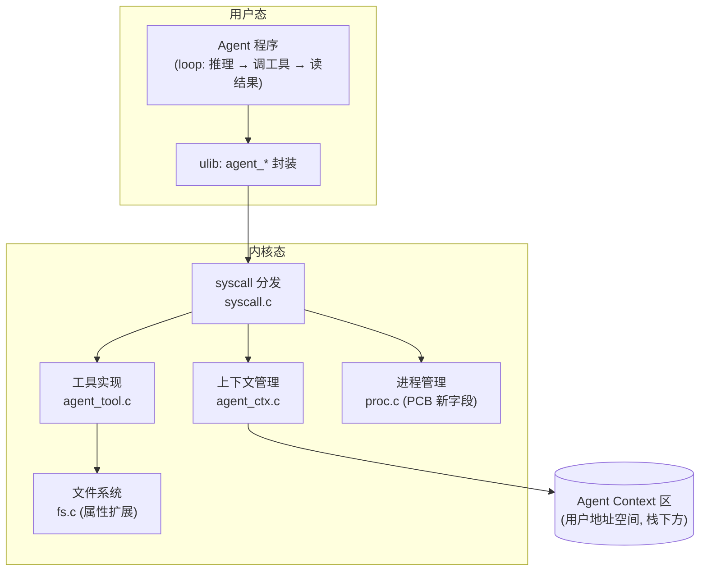

# Agent-OS 设计文档

> 状态：骨架（W1 建立，每周补一节）。最终版本用于比赛提交，需含架构图、内存布局、协议定义、
> 测试与性能数据、复现步骤。评审 25% 看文档，不要留到最后一周。

## 1. 背景与目标

（为什么"操作系统需要感知 Agent"：Agent 程序的工具调用是高频、结构化、有状态的；
传统 POSIX 接口只能表达"读写文件/创建进程"，无法表达"这次调用属于哪条推理路径"。）

## 2. 总体架构



## 3. Agent 进程模型（任务一）

- PCB 新增字段：`agent_type` `heartbeat_interval` `resource_quota` `loop_state` `ctx`
- Agent Context 区：位于用户栈下方的独立虚拟内存区，大小 = `resource_quota`
- 与普通进程共存：`agent_type == 0` 时行为与原生 xv6 进程完全一致

## 4. 上下文区内存布局（任务一 / 任务三）

```
高地址
+------------------+  <- 用户栈顶
|      用户栈       |
+------------------+  <- 栈底 (固定)
|                  |
|  Agent Context区  |   <- 向下增长，base + size 固定
|  节点: [len][data]|
|  ...             |
+------------------+  <- base
|   用户堆 / 数据段  |
低地址
```

FIFO 淘汰：`head` 指向最老节点，`tail` 指向写入位置，`used` `count` 只在 `ctx_account()` 里改。

## 5. 工具调用协议（任务二）

请求/响应结构见 `kernel/agent_proto.h`。要点：

- 定长头 + 变长键值对，不用 JSON（内核里不做解析器，省 800 行代码和一类漏洞）
- 所有用户指针必须 `copyin/copyout`，禁止内核直接解引用
- 错误码：0 OK / -1 E_TOOL / -2 E_ARG / -3 E_QUOTA / -4 E_FAULT / -5 E_BUSY / -6 E_IO / -7 E_NOSYS
- 内核实现的工具：`query_process` `query_file` `read_context` `send_message` `get_system_status`

## 6. 上下文路径管理（任务三）

`sys_context_push` / `query` / `rollback` / `clear`。
不变量：`used == Σ(节点长度+头)`，`count == 节点数`；超配额淘汰而不是 OOM。

## 7. Agent Loop 机制（任务五）

- 心跳：`timer_init` 里检查 `ticks - last_beat > heartbeat_interval` → 标记 `loop_state`
- 事件：`watch` 注册 (event_id, pid)，`wait` 走 `sleep()` 唤醒，注意 lost wakeup
- 多 Agent 调度：Agent 进程优先级 / 时间片与普通进程的差异

## 8. 文件系统扩展（任务四，加分）

文件键值属性：`sys_file_setattr` / `getattr` / `query`，属性存 inode 扩展区。

## 9. 场景验证（任务六 · 场景B Agent 系统管理员）

（脚本 + 演示流程 + 截图）

## 10. 测试与性能

| 用例 | 覆盖 | 结果 |
|---|---|---|
| t_agent_create | 创建/字段初始化/共存 | |
| t_ctx_overflow | 写满 10 万次 used 不增长 | |
| t_tool_err | 非法指针/未知工具返回正确错误码 | |
| perf_attr_vs_walk | 属性查询 vs 目录遍历 | |

性能数据用内核内 `rdtime` 计时（QEMU 上 `perf` 不可用），每组重复 3 次取中位数。

## 11. 复现步骤

```bash
make qemu          # 或 make test
```

## 12. 创新点

- 用户态/内核态划分：内容在用户态，元信息在内核（谁该知道什么）
- 协议设计：定长头 + 键值对，无解析器
- 跨进程共享上下文路径（可选）
- 基于历史路径的预取（可选）
